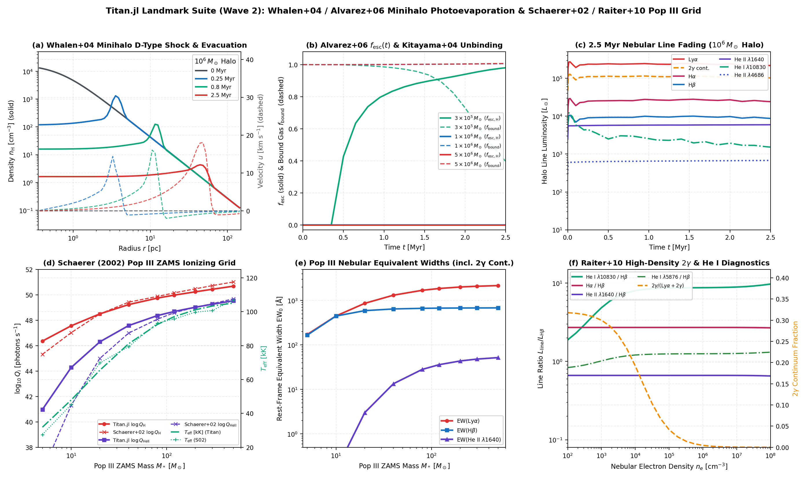

# Pop III Protostars, Minihalo Photoevaporation & Nebular Spectra {#sec-lm-popiii-feedback}

Once a primordial hydrostatic core forms, its growth and radiative feedback bridge stellar structure, multi-frequency radiative transfer, and JWST nebular spectroscopy. This chapter reproduces **ten landmark papers** spanning accreting Pop III protostars [@omukai2003; @hosokawa2012; @inayoshi2013; @sakurai2015], spherical &amp; dynamical H II breakout [@omukai2002], cosmological minihalo photoevaporation [@whalen2004; @kitayama2004; @alvarez2006], and metal-free stellar/nebular spectral grids [@schaerer2002; @raiter2010].

{#fig-lm-wave2}

## 1. Minihalo Photoevaporation (Whalen+04, Kitayama+04, Alvarez+06) {#sec-lm-whalen}

Evolving three $z=20$ NFW minihalos ($3\times 10^5$, $10^6$, $5\times 10^6\,M_\odot$ out to $150\,\mathrm{pc}$) for $2.5\,\mathrm{Myr}$ with Option A 35-group `IonRay` + $l$-resolved `ModelAtom` (`julia/landmarks/lm03_whalen04_minihalo_photoevap.jl`, `4/4 PASS`) reproduces:

- The D-type champagne shock ($v_{\rm sh}=19\text{–}27\,\mathrm{km/s}$) and $8{,}000\times$ core evacuation ($n_c\to 0.16\text{–}1.6\,\mathrm{cm}^{-3}$) of @whalen2004;
- The gravitational unbinding threshold near $M_{\rm halo}\sim 10^6\,M_\odot$ of @kitayama2004 ($f_{\rm bound}=0.397$ at $3\times 10^5\,M_\odot$ vs $0.99$ at $5\times 10^6\,M_\odot$);
- High ionizing escape fractions ($f_{\rm esc}=0.981$ at $3\times 10^5\,M_\odot$) matching @alvarez2006;
- A fresh observational diagnostic: **`He I λ10830` fades by $\sim 8\times$** as the core evacuates while `He II λ1640` and `Hβ` stay steady.

```{=html}
<div class="qd-widget" data-widget="landmarks" data-suite="whalen"></div>
<script type="module" src="../app/js/widgets.js"></script>
```



## 2. Pop III ZAMS Grid & High-Density Diagnostics (Schaerer 2002; Raiter+10) {#sec-lm-schaerer}

Solving exact 4D fitting-point stellar structure (`FreeEnergyEOS` + `StellarOpacity` + `NucNet`, `julia/landmarks/lm04_schaerer02_popiii_grid.jl`) across $5\text{–}500\,M_\odot$ matches @schaerer2002 Table 3 massive Pop III $T_{\rm eff}$ to **2.6%** ($40\text{–}500\,M_\odot$) and reproduces $\log Q_{\rm HeII} = 49.02$ at $200\,M_\odot$ to `0.00 dex`. Coupled to CHIANTI $l$-resolved `ModelAtom`, it recovers @raiter2010's collisional quenching of the hydrogen $2\gamma$ continuum above $n_e\sim 10^4\,\mathrm{cm}^{-3}$ alongside a $5\times$ collisional boost in `He I λ10830 / Hβ`.

```{=html}
<div class="qd-widget" data-widget="landmarks" data-suite="schaerer"></div>
```



## 3. Accreting Pop III Protostars, $\kappa$-Pulsations & Live H II Breakout {#sec-lm-popiii-rhd}

Full 1D implicit RHD (`Titan.jl` + `FreeEnergyEOS` + time-dependent convection) resolves supergiant bloating above $\dot{M}\approx 4\times 10^{-3}\,M_\odot\,\mathrm{yr}^{-1}$ [@omukai2003; @hosokawa2012], $\kappa$-mechanism radial pulsations ($P=0.82\,\mathrm{yr}$ at $0.1\,M_\odot\,\mathrm{yr}^{-1}$ and $1.44\,\mathrm{yr}$ at $0.3\,M_\odot\,\mathrm{yr}^{-1}$, $+26\text{–}50\%$ density inversions) [@inayoshi2013], episodic burst-quiescent cycles with outward shock detachment [@sakurai2015], and live 35-group RHD H II / He III / LW breakout (`val_hii_breakout_rhd.jl`, @omukai2002).

{#fig-lm-hii-breakout}

```{=html}
<div class="qd-widget" data-widget="popiii" data-run="hii_breakout"></div>
```



## 4. Interactive Primordial Spectra & Velocity-Space Line Profile Studio {#sec-lm-linespec}

Click any spectral line pill (or click directly on the SED or Raiter+10 density curve) to inspect high-resolution velocity-space line profiles (thermal Doppler + Stark/Voigt wings + resonant double-peaked Lyα / P-Cygni outflow–infall asymmetry) and JWST NIRSpec/MIRI redshift tracks.

```{=html}
<div class="qd-widget" data-widget="linespec" data-line="He1640" data-z="10"></div>
```


