## One picture, two very different objects

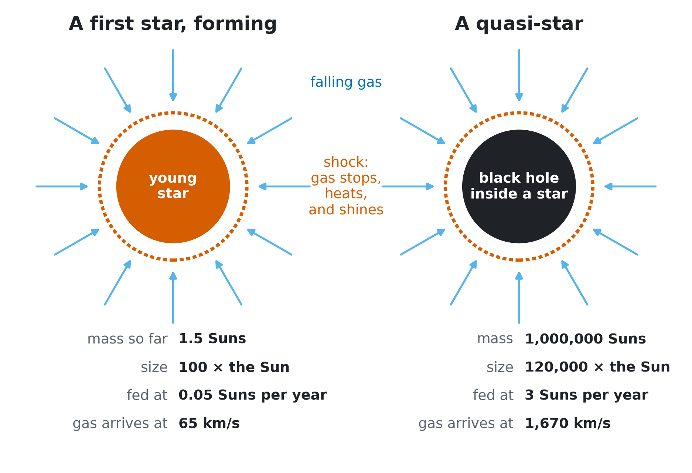{fig-align="center" height="790"}

::: notes
[1 min, total 1] Everything in this talk is this picture. Gas falls onto something. It slams to a stop in a shock, heats up, and shines. Left: one of the first stars in the universe, while it is still forming. Right: a quasi-star, a black hole buried inside a giant star, one proposed explanation for the Little Red Dots seen by JWST. The sizes differ by a thousand and the masses by a million, but the same code handles both. Numbers on the left are from a run still in progress.
:::

## Why this is hard

::: {.stats}
::: {.stat}

10²⁰

Range in density, from a cloud to the centre of a young star
:::
::: {.stat}

10,000 years → 10 seconds

The time step we need shrinks by a factor of 10¹⁰ during one run
:::
::: {.stat}

Light and gas

Each one controls the other, and neither can be solved first
:::
:::

 

::: {.takeaway}
So we need one code that stays stable across all of it, and tells us when it cannot.
:::

::: notes
[1 min, total 2] Three difficulties. A cloud's density rises by twenty powers of ten. Early on nothing happens for millions of years, later things change in seconds. Measured step: about 3e11 seconds at the start, tens of seconds at worst. And light is not a passenger: gas makes the light, light heats and pushes the gas.
:::

# The code {.section-slide}

## The idea: a star as nested shells, all solved at once

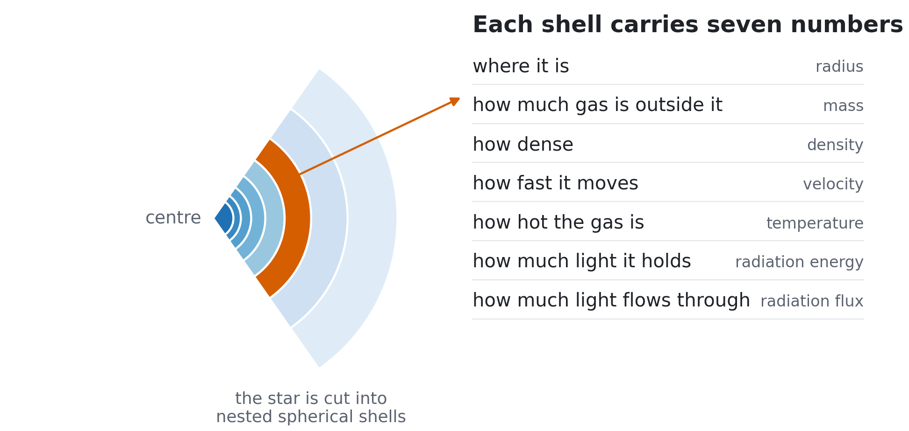{fig-align="center" height="560"}

::: {.takeaway}
Every shell is solved together with every other in each step, so a step can be far longer than the time sound needs to cross a shell.
:::

::: notes
[1 min, total 3] TITAN assumes spherical symmetry: one dimension. That is the price, and it is what makes 20 orders of magnitude affordable. Seven numbers per shell. Implicit means solving for all shells at the same time rather than marching them one by one, which allows long steps.
:::

## Shells can move in three ways, and each job needs a different one

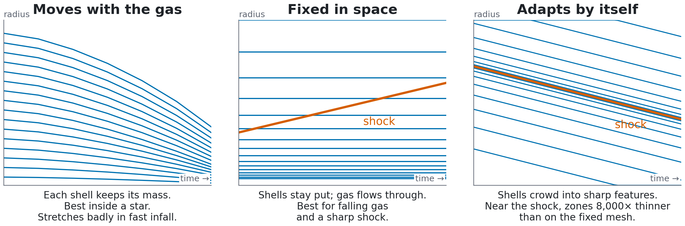{fig-align="center" height="550"}

::: {.takeaway}
Choosing the mesh is a physics decision. A fixed mesh for the falling gas removed the false oscillations of the shock that the moving mesh produced.
:::

::: notes
[1 min, total 4] Shells that follow the gas are natural for a star, but in fast infall they stretch enormously and the numerical viscosity starts to pull on them. The fixed mesh keeps the entire infall, which we need in order to know where light from the star goes later. The adaptive mesh found a thin hot layer behind the quasi-star's shock.
:::

## We can trust it: the Julia code matches the 1995 original

:::: {.columns}
::: {.column width="58%"}
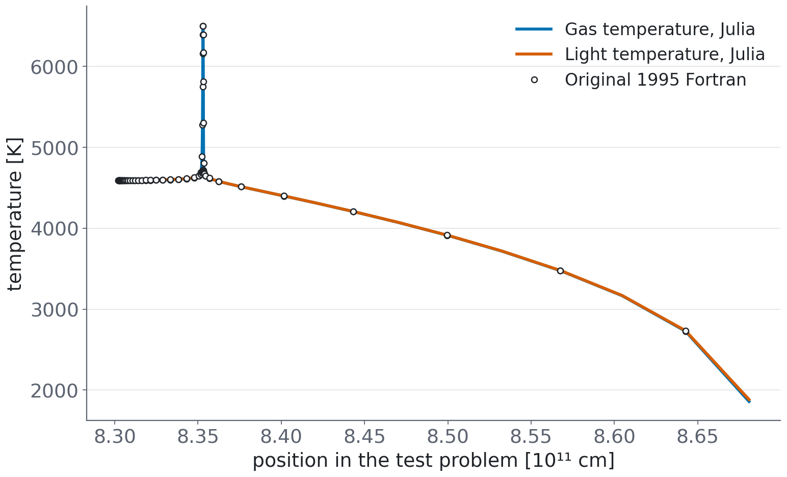{height="600"}
:::
::: {.column width="42%"}
Test: a shock so strong that its own light heats the gas ahead of it.

| Test | Steps, Julia | Steps, Fortran |
|---|---|---|
| Shock tube | 455 | 452 |
| Radiating shock, weak | 587 | 587 |
| Radiating shock, strong | 713 | 713 |

Every routine compared on every call, to 2 parts in 10¹¹.

No Fortran left at run time.

[tested]{.tag .tested}
:::
::::

::: notes
[1 min, total 5] TITAN is by Gehmeyr and Mihalas, 1994. We ported every routine, comparing it call by call against the original during full runs. Along the way we found two bookkeeping bugs in the original, in its clock and its energy diagnostic. Then the new physics was added on top of a verified base.
:::

## What the code can do today

::: {.cards}
::: {.card}
<b>Gravity</b>
The gas pulls on itself, down to a true centre, or a central mass such as a black hole
:::
::: {.card}
<b>Three kinds of mesh</b>
Moving, fixed, or adaptive; zones can be merged and split while conserving mass
:::
::: {.card}
<b>Long, stable steps</b>
Solves all shells together, with exact derivatives worked out by the code itself
:::
::: {.card}
<b>Chemistry</b>
9 species out of equilibrium, including H₂ and lithium; reactions run in both directions
:::
::: {.card}
<b>Nuclear burning</b>
19 species and 31 reactions, from deuterium burning to making carbon
:::
::: {.card}
<b>Convection</b>
A standard model of boiling gas: carries heat and mixes composition
:::
::: {.card}
<b>Light during the run</b>
Solved together with the gas; light from H₂ molecules followed colour by colour
:::
::: {.card}
<b>Spectra after the run</b>
Hydrogen with 12 energy levels; scattering off electrons simulated photon by photon
:::
::: {.card}
<b>Working practice</b>
Restart from any checkpoint; automated tests; a laboratory in the browser
:::
:::

::: notes
[0.5 min, total 5.5] Do not read these. The point is breadth: the same framework runs chemistry at 100 K and nuclear burning at 100 million K. The browser laboratory lives on the book's site, linked in the footer.
:::

# The physics inside {.section-slide}

## What the gas is made of changes with temperature

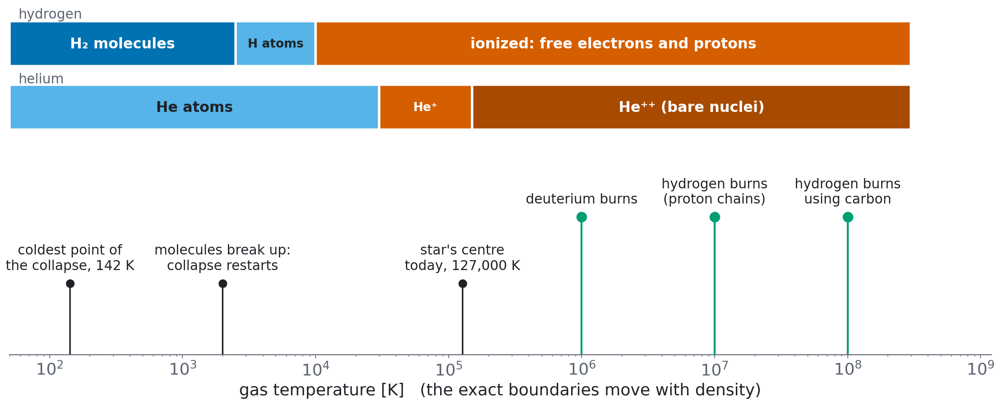{fig-align="center" height="620"}

::: {.takeaway}
Each change soaks up or releases energy, and changes how the gas cools. The code follows all of them.
:::

::: notes
[1 min, total 6.5] Read left to right. Below a few thousand degrees hydrogen can be molecules, the only coolant in a gas with no metals. When molecules break up the gas loses energy, can't hold itself up, and collapses again. Then atoms ionize. Far right is fusion: the first stars have no carbon, so they burn hot until they make a tiny bit themselves. Black marks: temperatures reached in our runs.
:::

## How light and gas trade energy

:::: {.columns}
::: {.column width="52%"}
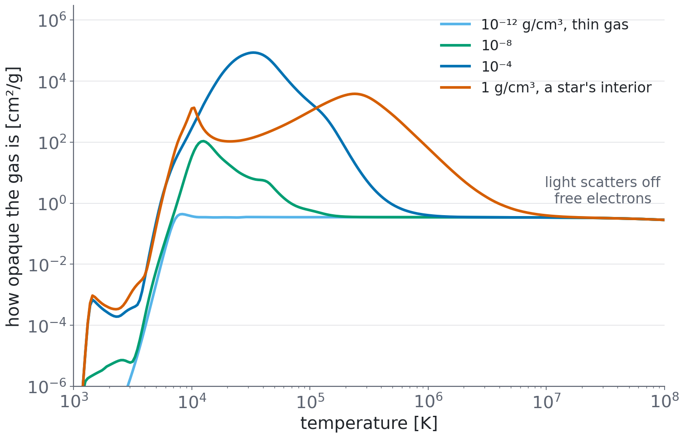{height="600"}
:::
::: {.column width="48%"}
| Process | Where it matters |
|---|---|
| H₂ molecules glow at 231 colours | The cold cloud |
| Colliding molecules; H⁻ ions absorb | Cold, dense gas |
| Atoms absorb light, lose an electron | 10⁴–10⁵ K |
| Electrons slow down near ions | Hot gas |
| Light scatters off free electrons | Hottest gas |
| Hydrogen and helium lines | Added to our tables |
| The cosmic background | Cloud edge |
:::
::::

::: notes
[1.5 min, total 8] The plot answers one question: how hard is it for light to get through this gas? Peaks mean light is stuck. At high temperature every curve joins the same floor: only electrons scatter. We rebuilt these opacity tables after finding a real bug in our own earlier version: it was too low by up to eight times, and now agrees with the independent OPAL tables to about 17% in thin gas. Dense gas near 30,000 K still differs by up to six times, so the stellar runs use OPAL there.
:::

## Three ways light gets out, and the code uses all of them

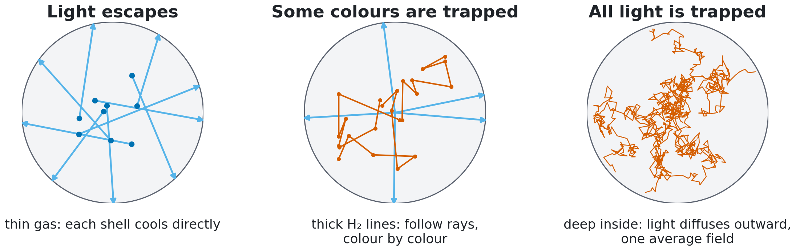{fig-align="center" height="550"}

::: {.takeaway}
In the collapsing cloud, these three stages follow each other at the centre, and they are visible on the collapse plot later.
:::

::: notes
[1 min, total 9] Left: light leaves immediately, so a shell just cools. Middle: only certain colours are stuck, so we solve for rays, colour by colour, and allow molecules to be out of equilibrium. This is the most expensive part of the calculation. Right: light does a random walk, and a single smooth field describes it. Everything outside the star stays in the left or middle state for the whole run, so we cannot simply assume diffusion everywhere.
:::

# What we have calculated {.section-slide}

## Seven calculations so far

| Calculation | Result | Status |
|------------|--------------|-----|
| Code tests against the 1995 original | Matches on all three benchmarks | [tested]{.tag .tested} |
| Quasi-star, steady | Two solutions, and a limit on feeding | [computed]{.tag .computed} |
| Quasi-star, fed, in time | Settles close to the steady answer | [computed]{.tag .computed} |
| Its spectrum | Bright hydrogen lines, no dust needed | [computed]{.tag .computed} |
| First-star cloud collapse | 20 powers of ten in density, to a young star | [computed]{.tag .computed} |
| Finished first stars, 15 and 100 Suns | Match published models closely | [computed]{.tag .computed} |
| Young star growing by accretion | 0.5 to 1.5 Suns so far | [in progress]{.tag .wip} |

::: notes
[0.5 min, total 9.5] Map of the second half. Quasi-star first, since it's complete and on the site, then first stars, which are moving quickly now.
:::

## Quasi-star: steady solutions exist only up to a limit

:::: {.columns}
::: {.column width="62%"}
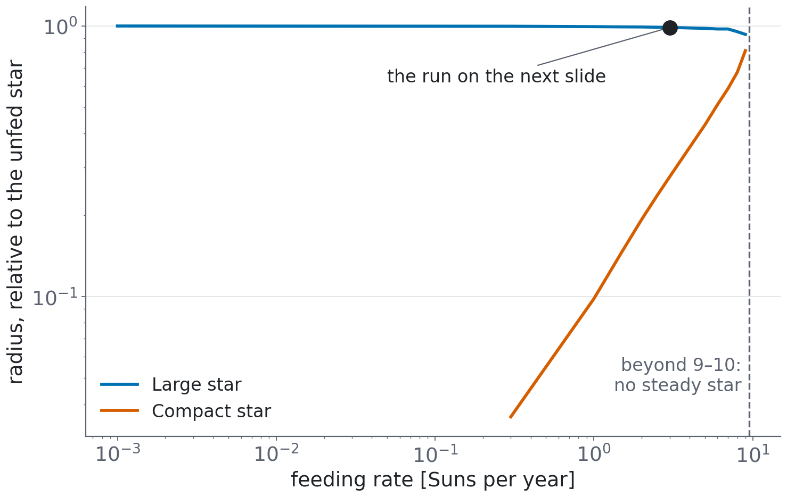{height="640"}
:::
::: {.column width="38%"}
Suppose the star just sits there while it is fed.

- Two possible stars at each feeding rate
- They merge at about 9–10 Suns per year
- Beyond that, no steady star exists

The steady model cannot say which one nature picks. For that we need time.

[computed]{.tag .computed}
:::
::::

::: notes
[1 min, total 10.5] This is the simple model: no time dependence, shock treated as a boundary. It raises the question of which branch nature chooses. Only a time-dependent run can answer.
:::

## In time, it settles near the large solution, and only the right mesh shows it

:::: {.columns}
::: {.column width="50%"}
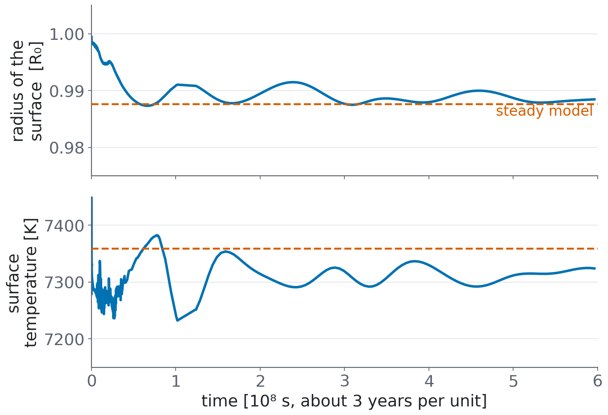{height="600"}
:::
::: {.column width="50%"}
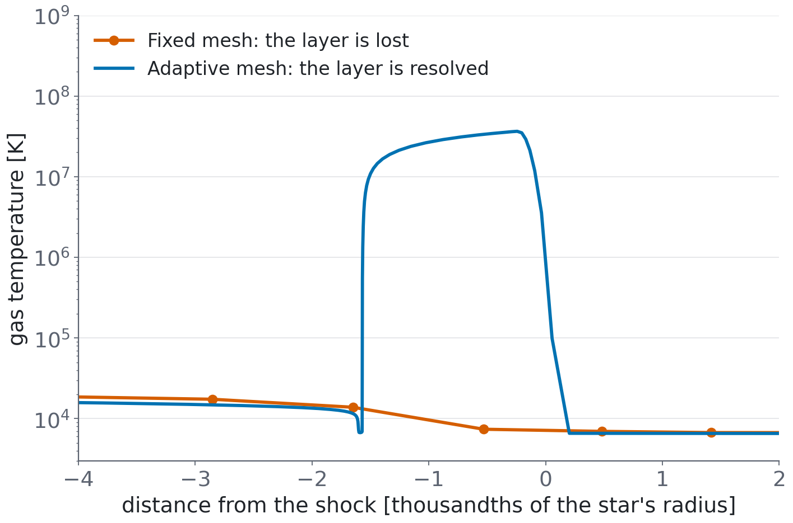{height="600"}
:::
::::

::: {.takeaway}
Fed at 3 Suns per year, it settles within 0.14% in radius and 50 K of the steady model. The shock layer reaches 37 million K.
:::

::: notes
[1.5 min, total 12] Left: the star, followed for about 20 years, settles near the steady solution. Agreement is close but not exact, and we have not proved why it differs. Right: the fixed mesh smears this hot layer into one cool zone and gets a different star; the adaptive mesh resolves it, and results converge at 220, 314 and 440 zones.
:::

## The star ionizes the gas falling onto it, and that sets its spectrum

:::: {.columns}
::: {.column width="42%"}
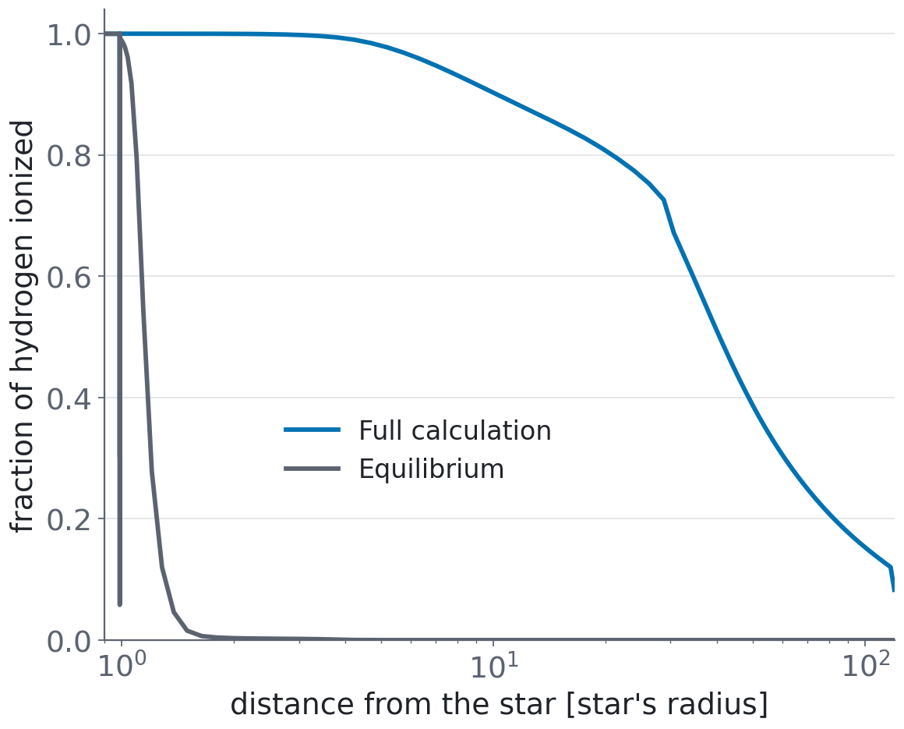{height="520"}
:::
::: {.column width="58%"}
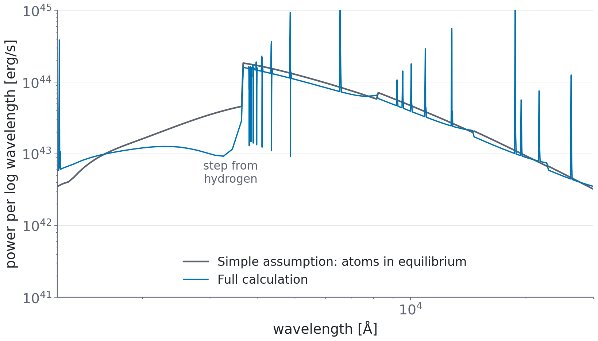{height="520"}
:::
::::

::: {.takeaway}
Hydrogen stays over 99% ionized out to 4 star radii, driven by the star's light, not by X-rays from the shock. Hydrogen's red line, Hα, comes out strong, with no dust.
:::

::: notes
[1.5 min, total 13.5] Left: the grey curve is what the simple equilibrium assumption gives, the blue is the real calculation. A completely different envelope. Right: the resulting spectrum. Hα is hugely bright, equivalent width about 800 Å. Hydrogen is computed with 12 levels out of equilibrium; helium stays in equilibrium, and temperature and density are held fixed from the run.
:::

## Against the Little Red Dots: a good start, not a match

| Property | Observed | Model | |
|---|---|---|---|
| Luminosity | about 10⁴⁴ erg/s and up | 1.4 × 10⁴⁴ erg/s | [yes]{.yes} |
| Strength of the red hydrogen line, Hα | up to 800–1700 Å | 805 Å | [yes]{.yes} |
| Narrow Hα core | about 300 km/s | 370 km/s | [yes]{.yes} |
| Hot dust | weak or absent | none | [yes]{.yes} |
| Surface temperature | about 5000 K | 7310 K | [too hot]{.no} |
| Hα wings | symmetric | one-sided | [no]{.no} |
| Absorption in Hα | common, mostly in gas moving toward us | none | [no]{.no} |
| X-rays | very weak | about 3.6× above one limit | [marginal]{.no} |

::: {.takeaway}
Next decisive step: two dimensions, with inflow and outflow together. A cooler star and metals would also change the answer.
:::

::: notes
[1 min, total 14.5] One model, one star, not a fit. Be honest about both columns. A cooler star we tried, at 5890 K, fixes some rows and worsens others, with Hα five times weaker. An outflow gives either symmetric wings or blueshifted absorbers, not both, in our simple kinematic test.
:::

## First stars: following one cloud from gas to a young star

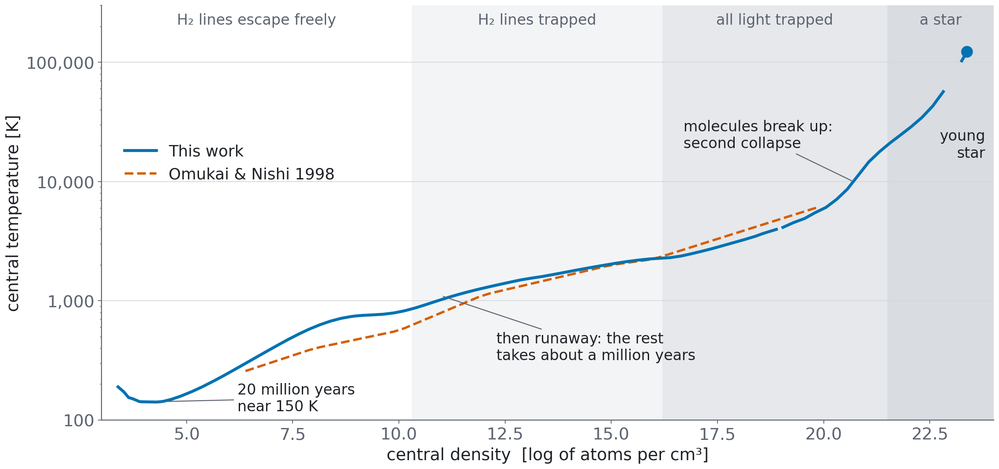{fig-align="center" height="740"}

::: notes
[1.5 min, total 16] A metal-free cloud at redshift 19, ten thousand Suns. The centre lingers near 150 K for 20 million years cooling through molecules; then runaway collapse. The dashed curve is a published calculation by Omukai and Nishi: we are within 4% between 10^13 and 10^16, up to 43% hotter around 10^11, a difference we have not traced, and 10 to 15% cooler below 10^20. When molecules break up, the second collapse makes a star. The shaded bands are the three ways of getting light out from earlier. Above density 10^19 the curve is from the run with the radiation solved together with the gas.
:::

## Finished first stars agree with published models

:::: {.columns}
::: {.column width="55%"}
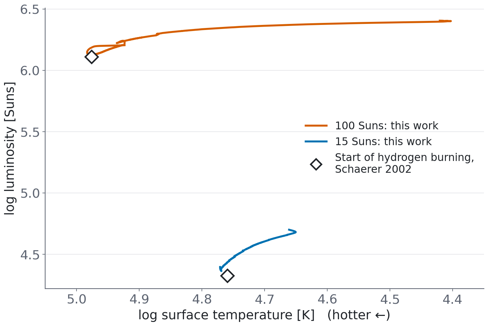{height="620"}
:::
::: {.column width="45%"}
| | 15 Suns | 100 Suns |
|---|---|---|
| Brightness, against Schaerer | 10% brighter | 5–15% brighter |
| Hydrogen-burning life, this work | 10.0 Myr | 3.0 Myr |
| Published (Schaerer) | 10.4 Myr | 2.74 Myr |
| Published (Marigo) | 11.3 Myr | 2.95 Myr |

Energy budget closes to 5 parts in 100,000.

[computed]{.tag .computed}
:::
::::

::: notes
[1 min, total 17] Before asking the code to grow a star, we checked that it can run a finished one: 15 and 100 Suns, through all of hydrogen burning, with the star making its own first carbon. The diamonds are the published starting points. Luminosity starts slightly above Schaerer. The convective-core boundary uses no overshoot, and lifetimes are sensitive to that.
:::

## Now: a young star fed by the whole cloud

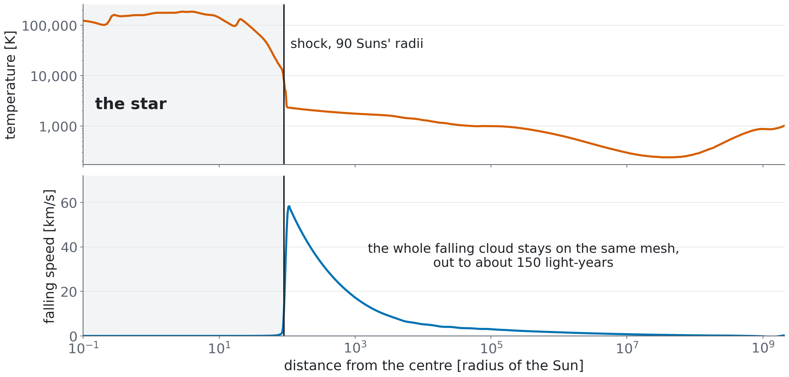{fig-align="center" height="630"}

::: {.takeaway}
Keeping the full infall on one mesh tells us where the star's light will go, what line emission escapes, and what speeds an observer would see.
:::

::: notes
[1 min, total 18] The same mesh runs from the centre through the star, the shock, and out to about 150 light-years. No boundary pretending to be a star. This matters for what comes next: the ionized bubble expands into this gas, so we need its density, speed and composition.
:::

## It grows steadily so far

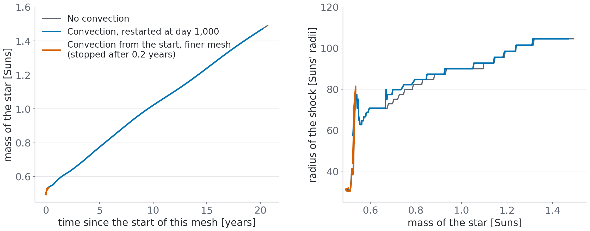{fig-align="center" height="600"}

[in progress]{.tag .wip} Two runs stop at about 1.5 Suns. The finer-mesh test reached its step limit after only 0.2 years, so it does not yet check the mesh. These numbers are not final.

::: notes
[0.5 min, total 18.5] Mass grows at about 0.05 Suns per year, and the shock moves out to about 100 solar radii. The steps in radius are the mesh spacing. Both coarse runs stop near 1.5 Suns at the same place near the shock, and we are looking into why. The orange run has a finer mesh but took much shorter steps, so its allowance of 10,000 steps covered only 0.2 years, at about 0.53 Suns. We have not yet compared with the published tracks of Omukai & Palla or Hosokawa.
:::

## Convection removes a false hot shell

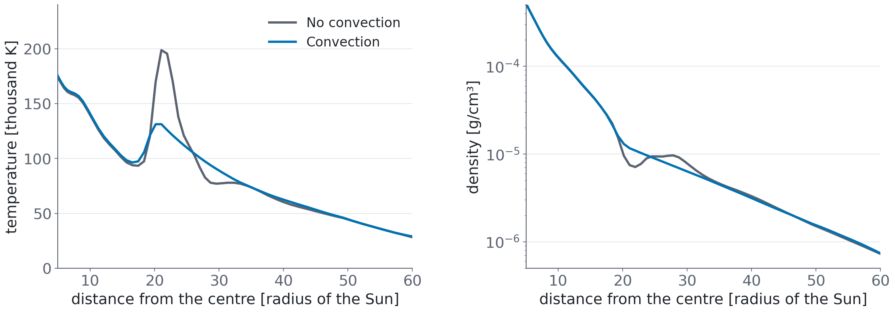{fig-align="center" height="520"}

::: {.takeaway}
Without convection, heavy gas sits on top of light gas, which cannot last. With convection on, it disappears.
:::

::: notes
[1 min, total 19.5] The star at 1 Sun in each run. A good example of the code telling us something was missing. Hydrogen ignition still needs nuclear abundances carried along the fixed mesh.
:::

## Summary

- **One code**, from 100 K to 100 million K, tested against the original line by line
- **Quasi-star:** it settles when fed, ionizes its own infall, and resembles Little Red Dots in key ways but not all
- **First stars:** we follow a cloud through 20 powers of ten in density, and finished stars match published models
- **Now:** growing a young star while keeping its whole infall

::: {.takeaway}
Next: resolve the 1.5 Sun stop, check the mesh, compare with published tracks, then carry on to hydrogen ignition and the light escaping into the cloud.
:::

::: notes
[0.5 min, total 20] End on what is next. Books and browser laboratory are at yipihey.github.io/titan.jl.
:::

# Backup {.section-slide}

## Plain words for the terms we use

| Term | Meaning |
|---|---|
| Shock | Where fast gas abruptly stops and heats |
| Opacity | How strongly gas blocks light |
| Ionized | Atoms stripped of electrons |
| Equilibrium (LTE) | Atoms set entirely by the local temperature, regardless of the light passing by |
| Convection | Hot gas rising and cool gas sinking; carries heat and mixes |
| Accretion | Growing by gas falling on |
| Hα | Red hydrogen line at 6563 Å |
| Little Red Dots | Compact red objects found by JWST in the early universe |

## Where each number comes from

| Slide | Run | Record |
|---|---|---|
| Test against 1995 | SOD, SUBC, SUPC | `docs/PORTING_NOTES.md` |
| Quasi-star settling | A220, A314, A440, R2 | The detailed book, ch. 7 |
| Spectrum | W30, W30d | The short book, ch. 1 and 4 |
| Little Red Dots | W30 with non-equilibrium hydrogen | The short book, ch. 5 and 6 |
| Collapse | `final2`, `rad`, `n3` | `docs/POPIII_NOTES.md` |
| Finished stars | `s5_p15e`, `s5_p100e` | `docs/POPIII_NOTES.md`, S5 |
| Young star | `c1`, `c2`, `c3` (uncommitted; all stopped) | `talk/data/accretion.csv` |

Figures: `talk/scripts/make_figures.py`. Pop III data: `talk/scripts/export_data.jl`.
